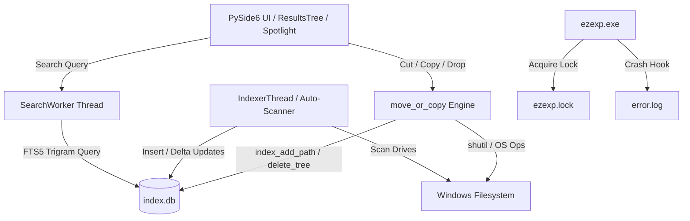

# EzExp

[](https://microsoft.com/windows)
[](https://python.org)
[-41cd52.svg)](https://pyside.org)
[](https://sqlite.org)
[](file:///d:/exp/ezexp)
[](LICENSE)

A Mac-style (clean white & grey, Finder/Spotlight-inspired) universal file finder and knowledge graph explorer for Windows. EzExp catalogs **every file on every fixed drive** into an instant local index, allowing you to search millions of files in milliseconds and jump straight to what you need — without digging through folders.

The executable is fully portable: single binary, zero external installers, no admin privileges required, storing everything cleanly inside its own application directory.

---

## Table of Contents

- [Core Highlights](#core-highlights)
- [Sharing EzExp with a Friend](#sharing-ezexp-with-a-friend)
- [Feature Walkthrough](#feature-walkthrough)
  - [1. Universal Instant Search](#1-universal-instant-search)
  - [2. Quick Search (Spotlight Bar)](#2-quick-search-spotlight-bar)
  - [3. Progressive Disclosure Graph](#3-progressive-disclosure-graph)
  - [4. Quick Launch & App Dock](#4-quick-launch--app-dock)
  - [5. File Organization (Cut, Copy, Paste & Drag-and-Drop)](#5-file-organization-cut-copy-paste--drag-and-drop)
  - [6. Details Pane & Rich Previews](#6-details-pane--rich-previews)
  - [7. Obsidian Vault Integration](#7-obsidian-vault-integration)
- [Architecture & Technical Design](#architecture--technical-design)
  - [Database & Storage Engine](#database--storage-engine)
  - [Two-Phase Schema & Lock Contention Defense](#two-phase-schema--lock-contention-defense)
  - [Scan Pipeline (Full vs. Incremental Delta)](#scan-pipeline-full-vs-incremental-delta)
  - [Single Instance & Exception Logging](#single-instance--exception-logging)
  - [Windows Shell & Clipboard Integration](#windows-shell--clipboard-integration)
- [Building from Source](#building-from-source)
- [Running Tests](#running-tests)
- [Troubleshooting & FAQ](#troubleshooting--faq)
- [Source Code Layout](#source-code-layout)

---

## Core Highlights

* **Sub-Millisecond Search Velocity**: Uses SQLite FTS5 with an ngram/trigram tokenizer to match prefixes, substrings, and extensions across millions of paths instantaneously.
* **Mac Finder Aesthetic**: Frosted titlebars, subtle borders, high-contrast row selection (`#0a84ff`), human-readable file sizes, and color-coded category badges.
* **Global Spotlight (`Alt+Space`)**: Summon an omnibar anywhere in Windows. Jump to files or launch apps without context switching.
* **Interactive Radial Knowledge Graph**: Visualize your filesystem and Obsidian notes as an interactive radial tidy-tree with progressive disclosure — click nodes to expand deeper branches without UI lag.
* **Explorer-Compatible Moving**: True Windows shell clipboard integration (`Preferred DropEffect`) for Cut, Copy, and Paste between EzExp and Windows Explorer, alongside native drag-and-drop.
* **Non-Destructive Operations**: Automatic Windows-style duplicate collision handling (`name (2).ext`) prevents accidental file overwrites.

---

## Sharing EzExp with a Friend

Distributing EzExp is as simple as sending `ezexp.exe` from the `dist/` directory:

1. **No Dependencies Needed**: The user does not need Python, Visual C++ runtimes, or administrative rights. Everything is bundled into the single standalone executable.
2. **Windows SmartScreen Notice**: Because the executable is not code-signed with an expensive commercial EV certificate, Windows SmartScreen may present a *"Windows protected your PC"* prompt on first launch. Click **More info → Run anyway**. This is a standard one-time prompt for unsigned open-source binaries.
3. **First Launch Cataloging**: On first launch, EzExp quietly catalogs all fixed drives (`C:`, `D:`, etc.) in a background worker thread. Search is responsive immediately, even while this initial indexing proceeds.
4. **Where Data Lives**: All index metadata and diagnostic logs are stored strictly under:
   ```
   %LOCALAPPDATA%\EzExp\
   ├── index.db       (SQLite index & FTS5 database)
   ├── ezexp.lock     (Single-instance mutex file)
   └── error.log      (Crash traceback capture)
   ```
   Deleting `%LOCALAPPDATA%\EzExp` resets the application to a pristine state.

Technical friends can clone this repository and run `build.bat` — it automatically installs Python via `winget` if missing, installs dependencies, and builds the executable.

---

## Feature Walkthrough

### 1. Universal Instant Search
The search bar at the top-right triggers asynchronous queries on every keystroke:
* **Category Filter Chips**: Narrow searches instantly to **Folders**, **Documents**, **Images**, **Videos**, **Music**, **Archives**, or **Code**.
* **Place Scoping**: Click any sidebar location (Drive, Desktop, Documents, or Obsidian Vault) to constrain searches within that subtree.
* **Client-Side Sorting**: Toggle sort modes on the fly: Name (A→Z), Newest Modified, Oldest Modified, Largest Size, or Smallest Size.

### 2. Quick Search (Spotlight Bar)
Press **`Alt+Space`** anywhere in Windows (or **`Ctrl+Alt+Space`** if another application binds `Alt+Space`) to summon the floating Spotlight omnibar:
* **`Enter`**: Launch the selected file or executable.
* **`Enter` on Folder**: Closes the bar and opens the folder inside the main EzExp window.
* **`Ctrl+Enter`**: Reveal the file highlighted in Windows Explorer.
* **`Esc`**: Dismiss the search bar.

### 3. Progressive Disclosure Graph
Click the **Graph** chip to switch from list browsing to the interactive radial tree view:
* **Progressive Disclosure**: Only high-level nodes are rendered initially. Nodes with unexpanded children display a violet `+` badge. Click a node to expand just that branch; right-click to collapse.
* **Radial Layout**: Automatic radial distribution (depth determines ring radius, angle sorts alphabetically, node radius indicates item count).
* **Obsidian Wikilink Visualizer**: When an Obsidian vault is scoped, document nodes visualize resolved `[[wikilinks]]` between visible notes, clustering interconnected knowledge organically.
* **Canvas Controls**: Left-click to select and view details; double-click to open; scroll to zoom; drag to pan.

### 4. Quick Launch & App Dock
Pin your most critical tools (`.exe`, `.lnk`, `.bat`, `.cmd`) in the sidebar:
* **Add Apps**: Click **＋ Add App…** to pin any program or script.
* **Shortcut Target Resolution**: EzExp automatically resolves `.lnk` shortcuts to their actual targets and extracts native Windows shell icons without shortcut arrow overlays.
* **Adaptive Frequency**: Frequently launched items automatically surface in your launch dock.
* **Single-click / Double-click**: Single-click scopes the app's folder in the details pane and graph view; double-click launches the application.

### 5. File Organization (Cut, Copy, Paste & Drag-and-Drop)
EzExp provides a complete file management engine that keeps the SQLite index in sync with disk operations:
* **Cut (`Ctrl+X`) & Copy (`Ctrl+C`)**: Multi-item selection with Explorer-compatible clipboard integration. Cutting in EzExp and pasting in Windows Explorer performs a move.
* **Paste (`Ctrl+V`)**: Paste into the selected folder or the currently browsed folder via shortcut or context menu.
* **Drag-and-Drop**:
  * Drag items within the tree to move them.
  * Hold **`Ctrl`** while dragging to copy.
  * Dragging files from Windows Explorer into EzExp copies them into the target directory.
* **Non-Destructive Collision Resolution**: If a destination file exists, EzExp renames the incoming file to `name (2).ext`, matching Windows Explorer behavior and preventing accidental data loss.
* **Directory Loop Guard**: Prevents moving a folder into its own subtree.

### 6. Details Pane & Rich Previews
Selecting an item opens the right-hand inspection sidebar:
* **Images**: High-fidelity scaled visual previews.
* **Videos**: Real video thumbnail extraction with an overlaid playback badge (clicking or pressing Open starts video playback in your default media player).
* **Text / Code / Markdown**: Live asynchronous syntax/text preview of the file head.
* **Folders**: Instant calculation of total direct subfolder and child file counts.
* **Quick Actions**: **Open**, **Show in Folder**, **Rename…**, **Copy as path**, **Copy file**, **Cut**, **Move to Recycle Bin**, and Windows **Properties**.

### 7. Obsidian Vault Integration
* Add vaults via **＋ Add Obsidian Vault…** in the sidebar.
* Vaults are preserved in user settings and automatically monitored on launch.
* Background workers scan `[[wikilink]]` references in `.md` files without freezing the user interface, persisting relationships in the `note_links` database table.

---

## Architecture & Technical Design



### Database & Storage Engine
EzExp uses SQLite 3 compiled with the FTS5 extension:
* **WAL Mode (`PRAGMA journal_mode=WAL`)**: Enables concurrent readers while the background indexer thread writes.
* **Trigram Tokenizer**: The full-text index tokenizes file names into 3-character sliding windows (`tokenize='trigram'`), allowing instantaneous matching of mid-word substrings (e.g. `report` matches `2026_financial_report_final.pdf`).
* **Database Location**: Stored at `%LOCALAPPDATA%\EzExp\index.db`.

### Two-Phase Schema & Lock Contention Defense
To guarantee that the UI never hangs on launch:
1. **`_ensure_schema(conn)`**: Runs synchronously on every database connection. It creates only the essential tables (`files`, `meta`, `note_links`, `fts`) and the single unique constraint index `idx_files_key ON files(parent, name)`. This takes <1 ms.
2. **`ensure_indexes(conn)`**: Performance indexes (`idx_files_parent_nc` with `COLLATE NOCASE`, `idx_files_parent`, `idx_files_drive`, `idx_files_mtime`, `idx_files_cat`, `idx_links_key`) are built asynchronously by the background `IndexerThread`.
3. **Lock Retry Strategy**: `db_connect()` includes a 180-second deadline loop that catches transient `sqlite3.OperationalError: database is locked` exceptions, sleeping 1 second between retries instead of crashing.
4. **Indexer Auto-Retry**: If the indexer thread encounters a lock, `MainWindow.on_index_done` reports *"Index busy — retrying in 5 s…"* and schedules an automatic retry.

### Scan Pipeline (Full vs. Incremental Delta)
* **Initial Full Scan**: Traverses all fixed Windows drives using `os.scandir`. System volumes (`$Recycle.Bin`, `System Volume Information`, `pagefile.sys`, `hiberfil.sys`) and NTFS junctions/symlinks are automatically skipped to avoid circular recursion.
* **Incremental Delta Scan**: Every 10 minutes (and on manual *"Rescan now"*), EzExp checks directory modification timestamps (`mtime`) against indexed rows. Only modified directories are traversed, completing in seconds.
* **State Persistence**: Scan state (`phase=full_done`) is committed only upon complete scan completion. Interrupted first-scans cleanly resume on the next launch.

### Single Instance & Exception Logging
* **Single Instance Mutex**: `QLockFile` (`%LOCALAPPDATA%\EzExp\ezexp.lock`) with `setStaleLockTime(0)` ensures that secondary launches display an *"EzExp is already running"* notification and exit gracefully without database corruption.
* **Crash Log Hook**: `install_crash_log()` wraps `sys.excepthook` to append unhandled exceptions and stack traces with ISO timestamps to `%LOCALAPPDATA%\EzExp\error.log`.

### Windows Shell & Clipboard Integration
* **File Operations**: Delete operations route through `shell32.SHFileOperationW` (with `FO_DELETE` and `FOF_ALLOWUNDO`) so items are safely sent to the Windows Recycle Bin rather than permanently erased.
* **Windows Clipboard**: Implements `Preferred DropEffect` format (`0x02` for Move/Cut, `0x01` for Copy), enabling seamless interoperability with Windows Explorer.

---

## Building from Source

### Prerequisites
* Windows 10 or 11 (64-bit)
* Python 3.10+ (If not installed, `build.bat` will install Python 3.12 automatically via `winget`)

### Automated Build (`build.bat`)
Simply run the included build script:
```cmd
build.bat
```
The script performs the following actions automatically:
1. Detects Python (`py`, per-user Python in `%LOCALAPPDATA%`, or triggers `winget install --id Python.Python.3.12`).
2. Installs required build dependencies: `PySide6`, `pyinstaller`, `pillow`.
3. Executes `make_icon.py` to generate the multi-resolution `ezexp.ico` (16x16 to 256x256).
4. Packages the application into a single standalone executable using PyInstaller and `version_info.txt`.
5. Emits the final binary at `dist\ezexp.exe`.

### Manual Build
If you prefer building manually in your virtual environment:
```cmd
pip install PySide6 pyinstaller pillow
python make_icon.py
pyinstaller --noconfirm --onefile --windowed --name ezexp --icon ezexp.ico --version-file version_info.txt app.py
```

---

## Running Tests

EzExp includes a test suite covering the database engine, FTS5 queries, delta scanner, GUI components, graph building, moving/copying, and lock resilience:

```cmd
py _test.py
```
Expected output:
```
ALL TESTS PASSED
```

---

## Troubleshooting & FAQ

### Search returns empty results or status bar says "Index error: database is locked"
Another background process or anti-virus scanner is holding a lock on `%LOCALAPPDATA%\EzExp\index.db`. 
* EzExp automatically retries index operations.
* If the database was corrupted by an abrupt power termination, close EzExp and delete `%LOCALAPPDATA%\EzExp\index.db`. Relaunching will rebuild the catalog cleanly.

### `Alt+Space` does not open the Quick Search bar
Another utility (such as PowerToys Run or an existing window manager) may have registered `Alt+Space`. EzExp detects this on startup, displays a notice in the status bar, and falls back to **`Ctrl+Alt+Space`**.

### How can I exclude a drive or folder from indexing?
By default, EzExp catalogs all fixed physical drives. To remove or add specific roots, Obsidian vaults can be managed in the sidebar. Full folder ignore patterns can be configured by filtering system attributes.

### How do I report a bug?
If EzExp encounters an unexpected issue, attach `%LOCALAPPDATA%\EzExp\error.log` when creating an issue report.

---

## Source Code Layout

| File | Purpose |
| :--- | :--- |
| [`app.py`](file:///d:/exp/ezexp/app.py) | Complete application: UI, widgets, scanner, move engine, graph canvas, and SQLite layer |
| [`_test.py`](file:///d:/exp/ezexp/_test.py) | Comprehensive test suite for backend, UI, clipboard, and lock resilience |
| [`build.bat`](file:///d:/exp/ezexp/build.bat) | Self-installing Windows batch script to build `dist/ezexp.exe` |
| [`make_icon.py`](file:///d:/exp/ezexp/make_icon.py) | Multi-resolution icon builder (`ezexp.ico`) |
| [`version_info.txt`](file:///d:/exp/ezexp/version_info.txt) | Windows PE version resource definition (`1.0.0.0`) |
| [`assets/logo/`](file:///d:/exp/ezexp/assets/logo) | High-resolution logo source files (SVG, ICO, PNG) and visual designs |
